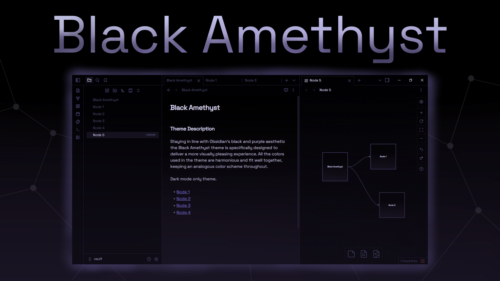

## Black Amethyst

# Theme Description

Staying in line with Obsidian's black and purple aesthetic the Black Amethyst theme is specifically designed to deliver a more visually pleasing experience. All the colors used in the theme are harmonious and fit well together, keeping an analogous color scheme throughout.

Dark mode only theme.

# Licence

This theme is released under the MIT Licence

# Font Credits

**Space Grotesk**

Copyright 2020 The Space Grotesk Project Authors
(https://github.com/floriankarsten/space-grotesk)
Licensed under the [SIL Open Font License, Version 1.1]

# Donations

[Kofi](https://ko-fi.com/josecostakf)
